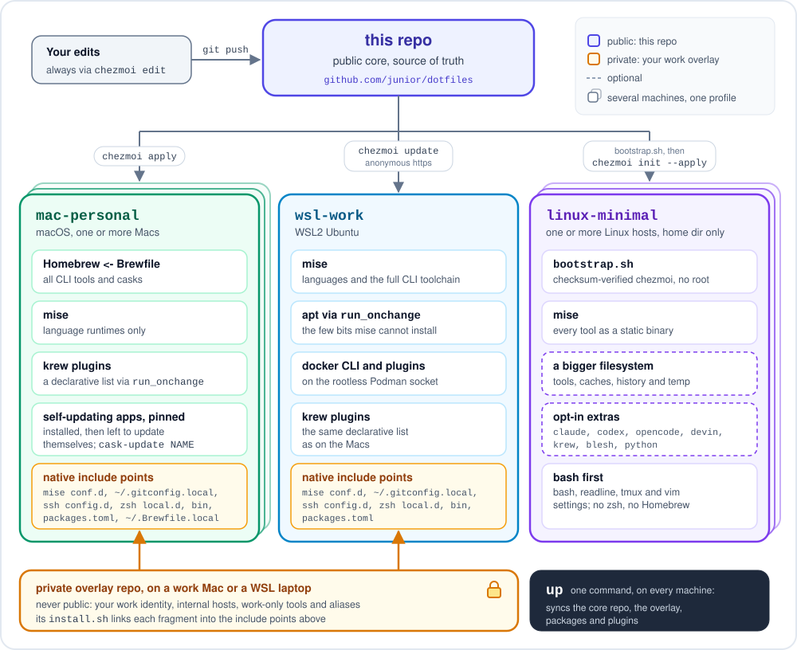

# dotfiles

[](LICENSE)

[](https://www.chezmoi.io)


Cross-machine dotfiles managed with [chezmoi](https://www.chezmoi.io).
One templated source, three very different kinds of machine, zero drift:

- **mac-personal**: personal MacBook (Homebrew, full freedom). This is a
  *profile*, not a single machine: any additional mac (say, an always-on mini
  running headless AI agents) joins with one `chezmoi init` and gets the
  identical setup.
- **wsl-work**: locked-down work laptop, WSL2 Ubuntu (mise, Podman, corporate network)
- **linux-minimal**: any Linux box where you get a home directory and nothing
  else: a jump host, a Raspberry Pi, a NUC. No root, no package manager, bash
  rather than zsh. chezmoi arrives through `bootstrap.sh`, every tool comes
  from mise as a static binary, and a nearly-full home is handled by moving the
  heavy parts to a bigger filesystem. See
  [linux-minimal](#linux-minimal-a-home-directory-and-nothing-else).

The `.zshrc` is ~85% identical between the two zsh machines; chezmoi keeps that shared core
single-sourced and isolates the differences in clearly-labelled template blocks.

Coding agents setting up a machine from this repo or a fork: read [AGENTS.md](AGENTS.md) first.

## Design principles

- **One repo is the source of truth.** Live files are never edited directly;
  everything flows through the source repo, so either machine can be rebuilt
  from scratch with one command.
- **Deliberate package-manager split.** The Mac is all-in on Homebrew
  (`dot_Brewfile.tmpl`); the WSL box is all-in on [mise](https://mise.jdx.dev)
  (per-project language pinning, prebuilt binaries, no root), and so is the
  minimal Linux profile, which additionally forbids itself anything that needs
  root or a package manager. Tools declare where they live; nothing is
  installed ad hoc.
- **Declarative, idempotent provisioning.** apt packages and krew plugins are
  lists in `run_onchange_*` scripts: edit the list, apply, done. The docker CLI
  plugins have a script that runs on every apply and updates them itself,
  comparing release tags first and degrading gracefully offline, so a sync never
  breaks.
- **Hostile-network survival.** SSH keepalives tuned for stateful corp
  middleboxes, fail-fast guards so an unreachable host costs 5 seconds instead
  of a 2-minute hang, and repo sync over plain HTTPS, the one protocol that
  corporate egress never mangles.
- **Employer bits stay out**: see [the overlay pattern](#work-overlay-keeping-employer-specific-bits-private) below.

## How it fits together



One `up` command per machine syncs everything above: core repo, overlay,
packages, and plugins.

## What's here

Every tool each machine installs is listed in **[TOOLS.md](TOOLS.md)**, grouped by category, one line each, with a link to its documentation. That
file is generated from the config files below and is never hand-edited,
so it cannot list something that is not actually installed.

| Source | Deploys to | Notes |
|---|---|---|
| `dot_zshrc.tmpl` | `~/.zshrc` | Shared core + per-machine blocks (pkg manager, certs, container runtime, aliases) |
| `dot_gitconfig.tmpl` | `~/.gitconfig` | delta pager; work identity layered in via `[include]` (not on linux-minimal) |
| `dot_bashrc.tmpl`, `dot_bash_profile.tmpl` | `~/.bashrc` | linux-minimal only: the bash profile (completions, fzf, history, prompt, `up`/`tools`/`footprint`) |
| `dot_inputrc.tmpl`, `dot_vimrc.tmpl`, `dot_tmux.conf.tmpl` | `~/.inputrc`, `~/.vimrc`, `~/.tmux.conf` | linux-minimal only: readline, vim paste toggle, a tmux config generated for the installed tmux version |
| `dot_config/bash/bc-compat.bash.tmpl` | shim | Stand-ins for the bash-completion helpers kubectl/helm completions expect |
| `dot_p10k.zsh` | `~/.p10k.zsh` | Powerlevel10k prompt (plain file) |
| `dot_Brewfile.tmpl` | `~/.Brewfile` | The Mac's entire toolchain, `brew bundle`-able; a machine's own `~/.Brewfile.local` is added at its end |
| `dot_config/mise/config.toml.tmpl` | mise config | Languages everywhere; the full CLI toolchain on WSL |
| `.chezmoitemplates/packages*` | - | A machine's own package changes, `~/.config/dotfiles/packages.toml`, applied to the Brewfile, the mise config, the installers and `up` (see [Work overlay](#work-overlay-keeping-employer-specific-bits-private)) |
| `examples/overlay/` | - | A complete sample overlay, with placeholders, to copy into a private repository of your own; never applied |
| `dot_config/kind/*.yaml.tmpl` | kind configs | Cluster presets: default, no-CNI, Calico (iptables/eBPF) |
| `dot_default-python-packages` | mise | Default pip packages for every Python (on linux-minimal only with the `python` extra) |
| `dot_local/bin/executable_tx` | `~/.local/bin/tx` | curl-only S3 file-transfer client (pairs with [s3tx](https://github.com/junior/s3tx)) |
| `dot_local/bin/executable_cask-update` | `~/.local/bin/cask-update` | mac: updates a pinned cask's app by hand, after a yes: quits it, unpins, upgrades, pins again, reopens it; `--check`, which `up` runs, names the apps behind their cask by the app's own version. `cask-update claude` is how the Claude desktop app is updated, its own updater being blocked |
| `dot_config/claude-desktop/block-auto-updates.mobileconfig` | `~/.config/claude-desktop/` | mac: the configuration profile that blocks the Claude desktop app's own updater; installed once, by hand |
| `dot_local/bin/executable_vaults` | `~/.local/bin/vaults` | one status line per Obsidian vault (changes, commits to push or pull, last commit) and `vaults pull` for all of them; POSIX sh, not on linux-minimal |
| `dot_local/bin/executable_kcx.tmpl` | `~/.local/bin/kcx` | mac: a kubeconfig file per cluster, a context picker, temp kind clusters on any Docker engine, and a read-only shell for AI tools; see [Kubeconfigs](#kubeconfigs-kcx) |
| `dot_zshenv.tmpl` | `~/.zshenv` | mac: `KUBECONFIG` and `~/.local/bin` for every zsh, coding agents' and ssh commands' included; on a `docker-engine` machine also the Homebrew PATH that ssh commands need |
| `private_dot_ssh/private_config` | `~/.ssh/config` | WSL-only: overlay include + keepalives for stateful-firewall networks |
| `run_onchange_install-apt-packages.sh.tmpl` | - | Declarative apt list (WSL) |
| `run_onchange_install-krew-plugins.sh.tmpl` | - | Declarative kubectl/krew plugin list (mac and WSL; on linux-minimal only when asked for via `extras`; bootstraps krew on Linux, skips without git) |
| `run_before_relocate-bigdisk.sh.tmpl` | - | linux-minimal: moves tool installs, caches and history to a bigger filesystem and links them back |
| `run_after_install-mise.sh.tmpl` | - | linux-minimal: checksum-verified mise, then every declared tool and its bash completion, reconciled on every apply |
| `run_after_setup-blesh.sh.tmpl` | - | linux-minimal: ble.sh, pinned and checksum-verified, for fish-style autosuggestions in bash; also splits `fzf --bash` into the files ble.sh's fzf integration reads |
| `dot_local/bin/executable_oscopy`, `executable_tmux-tidy` | `~/.local/bin/` | linux-minimal: copy to the clipboard of the machine you sit at over OSC 52; tidy stray tmux sessions |
| `bootstrap.sh` | - | Installs a static chezmoi with no package manager and runs the init; `--bigdisk DIR` keeps even that off a small home |
| `run_onchange_install-ebpf-tools.sh.tmpl` | - | bpftool & friends (WSL; upstream tarball quirks handled) |
| `run_onchange_install-wsl-integration.sh.tmpl` | - | An `xdg-open` that opens URLs and files with Windows' default apps (WSL) |
| `run_install-devin.sh.tmpl` | - | Devin CLI, installed when missing (WSL; linux-minimal with the `devin` extra) |
| `run_install-claude-code.sh.tmpl` | - | Claude Code, installed when missing with its native installer (WSL; linux-minimal with the `claude` extra) |
| `run_setup-docker-cli.sh.tmpl` | - | docker CLI against rootless Podman + self-updating `dhi`/`scout` plugins (WSL) |
| `run_check-claude-desktop-policy.sh.tmpl` | - | Checks that the profile above is in force and says how to install it when it is not (mac) |
| `run_pin-self-updating-casks.sh.tmpl` | - | Pins casks that update themselves, so brew never fights their updater (mac); `up` names any app that falls behind, and `cask-update` updates it |
| `gen-tools.py` | `TOOLS.md` | Regenerates the tool inventory; `--check` fails if the file is stale |
| `.chezmoi.toml.tmpl` | chezmoi config | Prompts once on init: the machine, and for linux-minimal a bigger filesystem and optional extras |

## First-time setup

1. Install chezmoi. `bootstrap.sh` does it on any machine, checksum-verified and
   without root, then runs step 2 for you:
   ```sh
   curl -fsSLO https://raw.githubusercontent.com/junior/dotfiles/main/bootstrap.sh
   sh bootstrap.sh              # add --bigdisk DIR when the home is small (Linux)
   ```
   Or use a package manager where one already exists: `brew install chezmoi`,
   `mise use -g chezmoi`. On an Intel Mac prefer the bootstrap: Homebrew has no
   Intel bottle for chezmoi, so `brew install` compiles it.

   **On a brand-new Mac there is an ordering catch.** Step 2 writes `~/.Brewfile`,
   and Homebrew is what reads it, but a factory-fresh Mac has no Homebrew. The
   bootstrap deliberately does not install it, because its installer is a piped
   shell script and those should be run knowingly. So: bootstrap, then install
   Homebrew from https://brew.sh by hand, then `up`. Between those steps the
   shell works but has no prompt theme or plugins, since they come from the
   Brewfile.
2. Initialise from this repo:
   ```sh
   chezmoi init --apply https://github.com/junior/dotfiles.git
   ```
   chezmoi prompts once for the machine (`mac-personal`, `wsl-work` or
   `linux-minimal`), then writes `~/.zshrc` or `~/.bashrc`, `~/.gitconfig`, etc.
   linux-minimal asks two more questions: a directory on a bigger filesystem
   for tools and caches (blank keeps everything in `$HOME`), and optional
   extras (`krew` for kubectl plugins, `blesh`, `python`, and the coding
   agents `devin`, `claude`, `codex` and `opencode`).
3. Reload: `exec zsh`, or `exec bash -l` on linux-minimal.

Using this for yourself? Put your own name and email in `~/.gitconfig.local`:
`~/.gitconfig` carries the maintainer's identity and includes that file last,
so without it your commits would carry the maintainer's name. Use this repo as
it is, or a fork that only tracks it, and keep what is yours outside it:
[AGENTS.md](AGENTS.md) lists where each thing goes.

## Daily workflow

| Action | Command |
|---|---|
| Edit a managed file | `chezmoi edit ~/.zshrc` |
| Preview pending changes | `chezmoi diff` |
| Apply pending changes | `chezmoi apply` |
| Pull a manual edit back into source | `chezmoi re-add ~/.p10k.zsh` |
| Sync from the remote (other machine) | `chezmoi update`; on linux-minimal use `up`, which re-runs `chezmoi init` so a changed config template is picked up |
| Open the source repo | `chezmoi cd` |
| Everything at once: repo, overlay, packages, plugins | `up` |
| See the toolchain by category | `tools` |
| What the setup occupies, and where (linux-minimal) | `footprint` |
| Refresh `TOOLS.md` after adding a tool | `./gen-tools.py` (from `chezmoi cd`) |

Templated files (`*.tmpl`) must be edited via `chezmoi edit`: editing the live
file and `re-add`-ing won't work because chezmoi can't un-template. Plain files
(like `dot_p10k.zsh`) re-add fine.

## linux-minimal: a home directory and nothing else

The third profile is for machines you do not administer: a jump host, or a
small box like a Raspberry Pi or a NUC where you would rather not depend on
the distro. It assumes only bash, git optionally, and a writable home.

What it does differently:

- **Nothing needs root or a package manager.** chezmoi is installed by
  `bootstrap.sh` from a checksum-verified release, using the static musl build
  because the glibc one needs a newer libc than enterprise distros ship. Every
  tool is a static binary from mise, and completions are generated from the
  tools themselves because bash-completion is usually not installed.
- **A small home stays small.** Answer the "bigger filesystem" prompt with a
  directory you own on the large disk (say, `/data/$USER`). Tool installs,
  caches, kubectl's discovery cache, shell history and temp files go there;
  `~/.local/share` and `~/.cache` become links; large binaries in `~/.local/bin`
  are parked there and linked back. chezmoi's own scripts, and everything they
  download, use that filesystem too, which matters on hardened hosts that
  mount `/tmp` noexec. The home ends up holding a few hundred KB of config.
- **The tmux config is generated for the tmux found at apply time**, because
  the mouse, copy-mode and styling syntax all changed between 2.1 and 2.9 and
  a jump host may well run 2.7.
- **Optional extras** are a comma-separated answer at init. `krew` adds the
  kubectl plugin manager and the plugin list from the other machines; it needs
  git, and is skipped with a message on hosts that have none. `blesh` adds
  [ble.sh](https://github.com/akinomyoga/ble.sh), fish-style autosuggestions
  from history (grey text after the cursor, Right arrow accepts) and syntax
  highlighting; it replaces bash's line editing, so it is a choice per host.
  `python` adds a current Python from mise (a precompiled build, so still no
  compiler and no root) plus [uv](https://docs.astral.sh/uv/). It exists
  because enterprise distros ship a `python3` years out of support (3.6 on
  EL8), where a script written today does not even parse. It is opt-in because
  mise's shims lead `PATH`: `python3`, `pip` and `#!/usr/bin/env python3`
  become the new build for you, while the host's own stays at
  `/usr/bin/python3` for the packaged tools that call it by absolute path.
  For a script with dependencies, `uv run --with requests script.py` builds a
  throwaway environment instead of leaving a venv to look after. Four extras
  add coding agents' command-line tools: `devin` the
  [Devin CLI](https://docs.devin.ai/), `claude`
  [Claude Code](https://code.claude.com/docs), `codex` OpenAI's
  [Codex CLI](https://github.com/openai/codex) and `opencode`
  [opencode](https://opencode.ai). The first two come from their own
  installers and update themselves; Codex and opencode come from mise. None
  needs Node.js. Each takes a few hundred MB, on the big disk where there is
  one, and runs on an old enterprise distro (proved on Oracle Linux 8). Signing
  in is yours, with no browser needed: `devin auth login
  --force-manual-token-flow`, `codex login --device-auth`, `opencode auth
  login` with a provider's API key, and for `claude` its own sign-in when you
  first run it. Each keeps its login under your home,
  readable by root on a shared host. To add an
  extra to a host later, edit the `extras` line in
  `~/.config/chezmoi/chezmoi.toml` and run `up`; a misspelt extra stops the
  apply with a message rather than silently doing nothing.
- **Terminal comforts that survive ssh and tmux:** Up/Down search history by
  what you typed, Ctrl-R fuzzy history, a prompt with the current kube context,
  `oscopy` to put output on the clipboard of the machine you are sitting at,
  `tmux-tidy` for stray sessions, and `jhelp` to list all of it. eza's file
  and folder icons are Nerd Font glyphs: the host just emits them, the terminal
  you sit at needs a Nerd Font to draw them. Without one, put an `ls` alias
  without `--icons` in `~/.config/bash/local.bash`, which is sourced last.

Daily use is one command, `up`: sync the private overlay if present, pull,
regenerate the config, apply, update mise tools and krew plugins, then print the
toolchain by category and `footprint`, what the setup occupies and where. It
reports only what changed; a run where nothing moved prints "all current".
mise itself is pinned in the repo rather than self-updated, so upgrading it
means bumping the pin; the same goes for ble.sh.

Leaving is one command. `sh bootstrap.sh --uninstall` shows the plan and
`--yes` runs it: managed files go, the distro's own `.bashrc` and
`.bash_profile` come back from `/etc/skel`, the links and chezmoi and mise are
removed, and the directory on the bigger filesystem is listed for you to delete
by hand. Nothing you created yourself is touched.

## Machine roles

`machine` says what KIND of setup a box has (`mac-personal`, `wsl-work`,
`linux-minimal`). It does not say what the box DOES. Several machines can share
one profile and still differ: one runs always-on agent sessions, another is a
build engine the others reach over ssh, a third holds credentials.

That is what `roles` is for. It is asked once, on `mac-personal` only, and
stored as a list in `~/.config/chezmoi/chezmoi.toml`. Pick roles by what the
machine is FOR, not by what happens to be installed on it:

| role | pick it when | what it turns on |
| --- | --- | --- |
| *(blank)* | an ordinary workstation, which is the common case | nothing |
| `session-host` | the machine runs long-lived agent sessions others connect to | a launchd job, and `up` restarts it after the CLI is upgraded |
| `docker-engine` | other machines run builds on this one's Docker engine over ssh | a PATH line in `~/.zshenv`, so a non-interactive `ssh host command` can find `docker`; `kcx add` refuses there, a lab node holding no credentials |
| `secrets` | the machine holds credentials provisioned from a password manager | the templates that write those files |

Roles rather than machine names, because **a role moves and a name does not**.
When the desktop is down, session hosting shifts to the laptop by editing one
line in a config; nothing in this repo changes.

An unknown role stops `chezmoi init` and names it, because a typo would
otherwise produce a machine that silently never does the thing.

`chezconf` prints what the current machine has, which is also what `up` shows
you if chezmoi reports that the config template changed. Existing answers are
never lost: every prompt reuses a value already present and asks only about
genuinely new fields. To CHANGE one, edit the config file directly.

Lab machines reachable over ssh are configured next to this, as `lab_hosts`,
in `alias:hostname` pairs. The hostnames stay in your own config rather than in
this repo, so a public fork carries the structure and none of your addresses.
The alias half can hold several names separated by spaces.

## Kubeconfigs (kcx)

On the Macs every cluster gets a kubeconfig file of its own, so importing one
cluster can never overwrite another one's credentials, which is what happens when
every tool merges into `~/.kube/config`. `kcx` (`~/.local/bin/kcx`, `kcx -h`)
keeps this layout:

| path | holds |
| --- | --- |
| `~/.kube/config` | the current context, and nothing else of kcx's. kubectl writes `current-context` into the first file of `KUBECONFIG`, so this one comes first and a switch never rewrites a file that holds credentials. A tool that writes "the default kubeconfig" lands here too: `kcx ls` points it out, and `kcx adopt` moves it into a file of its own |
| `~/.kube/configs/NAME.yaml` | one permanent cluster; import renames its cluster, user and context to `NAME` |
| `~/.kube/temp/NAME@ENGINE.yaml` | one temp kind cluster, `ENGINE` being the docker context it runs on; deleted with the cluster |

`KUBECONFIG` lists them in that order. `~/.zshenv` sets it, because zsh reads that
file in every shell: terminals, the `zsh -c` and `zsh -lc` that coding agents run
their commands in, and `ssh host command`. It is recomputed for each new shell and
before each prompt, and a `KUBECONFIG` someone set on purpose is left alone. `kcx env`
prints it for any other shell.

- `kcx` picks a context with fzf; `kcx NAME`, `kcx -` and `kcx -c` switch, go back
  and print the current one (`kc` and `kcc` are aliases). kubectx works on the same
  files.
- `kcx add NAME FILE`, `kcx add NAME -` (standard input) or `kcx add NAME -- CMD...`
  imports a cluster. The last form runs a provider's own command with `KUBECONFIG`
  pointed at a new file, for example `kcx add eks-lab -- aws eks update-kubeconfig
  --name lab`, and replaces `{}` with that file's path for tools that take a file
  option instead. `kcx rm` moves a file to the Trash; `kcx mv` renames one.
- `kcx temp create NAME [--engine CONTEXT] [--config PRESET]` runs kind with the
  presets in `~/.config/kind`. On a remote engine, a docker context over ssh, the API
  server listens on that machine's network address, which kind also puts in its
  certificate, so the cluster works from the machine that made it. `kcx temp ls`,
  `kcx temp rm` and `kcx temp prune` look after them.
- `kcx run NAME -- CMD...` runs one command against one cluster without touching the
  current context. `kcx -r [NAME] [-- CMD...]` opens a read-only shell, or runs one
  read-only command, through a local `kubectl proxy` that refuses writes, exec, attach
  and port-forward. Its kubeconfig holds no credentials and stays in place through
  the shell's own startup files.

**Agents** share one current context with every other shell, so a switch made in one
session points kubectl in all the others at a different cluster. They name the
cluster per command instead, `kubectl --context NAME` or `kcx run NAME -- CMD`, and
use `kcx -r` for anything that only reads. `kcx add` and `kcx temp create` never
switch unless given `--use`. A shell that started before a cluster was added does
not list it yet: `kcx run` works at once, and `eval "$(kcx env)"` brings the shell
up to date.

On a `docker-engine` machine `kcx add` refuses, a lab node holding no credentials;
temp clusters are fine there. Apps started from the Dock do not see `KUBECONFIG`:
add `~/.kube/configs` and `~/.kube/temp` to their kubeconfig settings.

## Work overlay (keeping employer-specific bits private)

This public repo is the **core**. Anything employer-specific (internal tool
registries, work email, corporate git hosts, work-only shell tooling) lives in
a separate **private overlay** repo, never here. The two are joined entirely by
each tool's *native* include mechanism, so the public core stays standalone and
clonable by anyone:

| Layer | Public core | Private overlay |
|---|---|---|
| mise tools | `~/.config/mise/config.toml` | `~/.config/mise/conf.d/*.toml` (mise auto-merges) |
| git identity | personal default | `~/.gitconfig.local` (via `[include]`) |
| ssh hosts | `Include ~/.ssh/config.d/*` | files in `~/.ssh/config.d/` |
| shell | sources `~/.config/zsh/local.d/*.zsh` | files in `~/.config/zsh/local.d/` |
| commands | `~/.local/bin` is on `PATH` | links in `~/.local/bin/` |
| Homebrew (Mac) | `~/.Brewfile` | `~/.Brewfile.local`, added at the end of `~/.Brewfile` |
| public packages | everything in [TOOLS.md](TOOLS.md) | `~/.config/dotfiles/packages.toml`: skip one, or replace it with another build |

The overlay is a plain repo with an `install.sh` that symlinks its fragments
into those paths; an `up` shell function keeps everything (core, overlay,
packages) in sync with one command. Result: one public repo to share, zero
employer details in it, and a work machine that's still fully configured.

It works the same on a work Mac as on WSL. On a Mac, `~/.ssh/config` stays your
own file: once an overlay sits at `~/.local/share/dotfiles-overlay`, the next
apply adds `Include ~/.ssh/config.d/*` at its top, keeping a backup, so the
overlay's hosts are read.

### Starting an overlay

Keep the overlay in a **private** repository: on your employer's git host, or a
private repository of your own. Never put it in a fork of this repo, and never
make it public; it holds your work identity, internal host names and the names
of internal tools. Clone it on the work machine only, to
`~/.local/share/dotfiles-overlay`, where `up` looks for it. A layout that uses
every include point above; [examples/overlay/](examples/overlay/) holds it with
placeholder contents, ready to copy:

```text
dotfiles-overlay/              a PRIVATE repo, cloned to ~/.local/share/dotfiles-overlay
|-- install.sh                 links everything below into place; up runs it
|-- git/gitconfig.local        -> ~/.gitconfig.local                     work name and email
|-- zsh/work.zsh               -> ~/.config/zsh/local.d/work.zsh         work aliases, environment
|-- mise/conf.d/work.toml      -> ~/.config/mise/conf.d/work.toml        work-only CLI tools
|-- ssh/config.d/work          -> ~/.ssh/config.d/work                   work hosts
|-- bin/                       -> ~/.local/bin/, one link per file       work scripts
|-- packages.toml              -> ~/.config/dotfiles/packages.toml       public packages to skip or replace
`-- Brewfile.local             -> ~/.Brewfile.local                      extra Homebrew packages (Mac)
```

Leave out what you do not need. A minimal `install.sh`:

```sh
#!/bin/sh
# Link this overlay's pieces where the public dotfiles read them. `up` runs it
# after every pull, so it is safe to run again, and it never replaces a real file.
set -eu
here=$(cd "$(dirname "$0")" && pwd)

link() {  # link SOURCE TARGET; SOURCE is relative to this repo, skipped when absent
  [ -e "$here/$1" ] || return 0
  if [ -e "$2" ] && [ ! -L "$2" ]; then
    echo "install.sh: $2 is a real file, left as it is" >&2
    return 0
  fi
  mkdir -p "$(dirname "$2")"
  ln -sfn "$here/$1" "$2"
}

link git/gitconfig.local "$HOME/.gitconfig.local"
link packages.toml       "$HOME/.config/dotfiles/packages.toml"
link Brewfile.local      "$HOME/.Brewfile.local"
for pair in zsh:.config/zsh/local.d mise/conf.d:.config/mise/conf.d \
            ssh/config.d:.ssh/config.d bin:.local/bin; do
  for f in "$here/${pair%%:*}"/*; do
    link "${pair%%:*}/${f##*/}" "$HOME/${pair#*:}/${f##*/}"
  done
done
```

### Replacing or skipping a public package

A work Mac may have to install a company build of a tool instead of the public
cask; Claude Code is the usual case. The overlay says so in its
`packages.toml`:

```toml
# Public packages this machine does not install.
skip = ["lm-studio"]

# Public packages this machine gets in another build.
[replace]
"claude-code@latest" = "acme/tap/claude-code"
```

At the next apply, `~/.Brewfile` has `cask "acme/tap/claude-code", trusted:
true` where `cask "claude-code@latest"` was, with a comment line saying what
changed (`trusted: true` is how a Brewfile lets Homebrew load a cask from a
third-party tap). `up` follows the new cask too: after it upgrades, `up`
restarts a Remote Control server that runs from it, and a replaced cask that
was pinned is pinned under its new name.

- **Names** are the ones the public files use, or the ones TOOLS.md shows,
  without a tap or backend prefix: `claude-code@latest` is the Mac's cask,
  `claude-code` the native installer on WSL and linux-minimal, and `opencode`
  and `github:anomalyco/opencode` are the same tool. A name the machine does
  not install is ignored, so one file can serve several machines.
- **In the mise config** a replaced tool is left out, like a skipped one:
  declare its replacement in the overlay's `mise/conf.d`. It has to be that way
  round, because when the same tool is in both files, mise takes
  `config.toml`'s.
- **The installers** of Claude Code, the Devin CLI, sbx, bpftool and ble.sh
  step aside for a name that is skipped or replaced; the overlay installs its
  own build, from `install.sh`, `bin/` or mise conf.d.
- **The kubectl plugins** (krew) leave out a skipped plugin and install a
  replaced one under its new name, `INDEX/NAME` for one from another krew index.
- **Additions** need no entry here: Homebrew packages go in `Brewfile.local`,
  command-line tools in mise conf.d.
- **A mistake stops the apply** with a message: an unknown key, a malformed
  name, a name both skipped and replaced, a link whose file is gone (each named
  with the file), or broken TOML (named with its line). Ignored, a typo would
  install the very package the file was written to keep off the machine.

On a new machine, clone the overlay and run its `install.sh` before the first
`chezmoi init --apply` or `up`, so the first `~/.Brewfile` already has the
replacement. After that, `up` syncs the overlay before it applies the dotfiles,
so a change to `packages.toml` takes effect in the same run. Nothing is ever
uninstalled for you: a public package installed before the overlay arrived
stays, and `up` names it, with the command that removes it. The apt and
docker-plugin lists, mise itself, and the npm and Python default packages do not
read `packages.toml`.

## Bootstrapping a brand-new repo from this layout

```sh
chezmoi init                          # creates ~/.local/share/chezmoi
cp -r ./* ./.chezmoi* "$(chezmoi source-path)"/
chezmoi apply
cd "$(chezmoi source-path)"
git init && git add . && git commit -m "initial dotfiles" && git push -u origin main
```

## License

[MIT](LICENSE)
